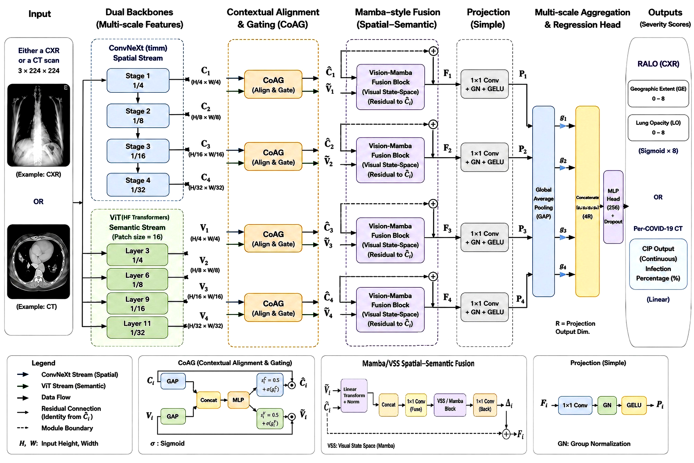

# HyS-Mamba for Lung Infection Severity Regression

Author implementation accompanying **“HyS-Mamba: A Hybrid Semantic-Spatial Mamba Network for Lung Infection Severity Regression from Chest Imaging”**, submitted to *Biomedical Signal Processing and Control*.

HyS-Mamba combines a ConvNeXt spatial stream, a frozen Vision Transformer semantic stream, contextual alignment gating (CoAG), and visual state-space fusion for image-based severity regression.



## Highlights

- Trainable ConvNeXt-Tiny spatial encoder and frozen `google/vit-base-patch16-224` semantic encoder.
- Intermediate ViT hidden states at indices `{3, 6, 9, 11}`, resized to the four convolutional feature-map resolutions. The ViT itself uses a fixed patch grid.
- CoAG produces two channel-scaling vectors conditioned on both branches, with scaling `0.5 + sigmoid(g)`.
- Mamba-style fusion using the supplied TinyViM-derived `TViMBlock` / `SS2D` implementation.
- Simple projection, multi-scale pooling, and a regression head in the final supplied configurations.
- Two bounded RALO predictions, `[GE, LO] = 8 × sigmoid(logits)`, or one linear Per-COVID-19 infection-percentage prediction.
- Attached author trainer, datasets, losses, metrics, optimizers, schedulers, baseline encoder, and architecture ablations.

The `DINO` names in source files are historical architecture names. The supplied configurations load the Hugging Face ViT weights above, not DINO-pretrained weights.

## Reported results

Rounded test results reported in the attached revised manuscript; these are not new runs of this repository.

| Benchmark | Modality | Target | MAE ↓ | Target scale |
|---|---|---|---:|---|
| RALO | Chest X-ray | Geographic extent (GE) | **0.202** | 0–8 |
| RALO | Chest X-ray | Lung opacity (LO) | **0.171** | 0–8 |
| Per-COVID-19 | CT | Infection percentage (CIP) | **3.201** | 0–100 |

The supplied RALO configuration specifies a 256-unit hidden head. The manuscript identifies a 512-unit head in the recovered RALO checkpoint used for statistical analysis. Both configuration shapes are provided; use the one matching the checkpoint. Checkpoints, original data, and expanded RALO images were not part of the supplied project files and are not distributed here.

## Repository structure

| Path | Contents |
|---|---|
| `src/age_estimation/models/HySMamba_regression.py` | Attached hybrid model, CoAG, fusion, projection and ablations |
| `src/age_estimation/models/DINO_encoder_regression.py` | Attached encoder regression baseline |
| `src/age_estimation/models/tiny_vim/tvimblock.py` | Attached TViMBlock, SS2D and selective-scan interface |
| `src/age_estimation/datasets/pkl_dataset.py` | Per-COVID-19 CSV and RALO raw/expanded loaders and split indices |
| `src/age_estimation/trainer.py` | Attached Accelerate trainer and checkpoint manager |
| `src/age_estimation/utils/data.py` | Attached image transform builder |
| `configs/dino_ViM_CT.py` | Supplied CT experiment settings, portable dataset paths |
| `configs/dino_ViM_ralo.py` | Supplied RALO settings, 256-unit head |
| `configs/dino_ViM_ralo_512.py` | RALO structural variant for a matching 512-unit checkpoint |
| `scripts/` | Training launcher, evaluation, CUDA check, and source validation |
| `docs/source_manifest.json` | Mapping and checksums of the supplied code files |
| `docs/implementation_notes.md` | Packaging changes and reproducibility details |

The `age_estimation` package name is retained for compatibility with the attached code and registry names.

## Installation

Use Python 3.10 or later and a CUDA-capable NVIDIA GPU for the supplied state-space implementation. Install the PyTorch/torchvision pair appropriate for your CUDA environment, then install this package:

```bash
python -m venv .venv
source .venv/bin/activate
pip install -U pip
pip install -e .
```

Optional MLflow tracking:

```bash
pip install -e '.[tracking]'
```

### Selective-scan CUDA extension

`selective_scan_cuda` is a separate compiled dependency and is not bundled in the attached files. Follow the environment instructions in [TinyViM](https://github.com/xwmaxwma/TinyViM#-use-example) and the linked [VMamba selective-scan implementation](https://github.com/MzeroMiko/VMamba/tree/main/kernels/selective_scan). Use a build exposing the `selective_scan_cuda.fwd` / `bwd` signatures called in the supplied `tvimblock.py`; differently named CUDA variants are not interchangeable by renaming imports.

Verify the installed extension with an actual TViMBlock forward and backward pass:

```bash
python scripts/check_environment.py
```

The original model contains a convolution fallback when TViMBlock cannot be imported or constructed. The supplied training and evaluation entry points reject that fallback to avoid running a different architecture under the HyS-Mamba name.

The dependency ranges are packaging constraints, not a recovered lockfile from the experiments. CUDA execution must be checked in the target training environment.

## Dataset preparation

Set `HYSMAMBA_DATA_ROOT` to the directory containing the two datasets:

```bash
export HYSMAMBA_DATA_ROOT=/path/to/datasets
```

### Per-COVID-19 CT

The CT configuration uses the supplied directory name and predefined CSV splits:

```text
/path/to/datasets/
  CT_Dataset (per-covid-19-slices)/
    Train.csv
    Val.csv
    Test.csv
    Train/...
    Val/...
    Test/...
```

Each CSV has no header and contains `image,cip,flag`. Image filenames resolve below the dataset root or the corresponding split folder. The loader uses `cip` as the scalar label; `flag` is read but is not a regression target. Images are converted to three channels and resized to 224 × 224.

### RALO

The supplied configuration expects the expanded dataset:

```text
/path/to/datasets/
  RALO_Aug/
    lung_rep1.csv
    Lung_Rep1/
      0.jpg
      1.jpg
      ...
```

The expanded CSV has a header including `Left Geo`, `Right Geo`, `Left Opacity`, and `Right Opacity`. With `aug_label_mode='avg_lr'`, the two targets are the left/right averages. CSV row `i` must correspond to image `i.jpg`; the original row ordering must be preserved because the test partition uses fixed row indices.

The original RALO loader and split-index lists are also included. For raw RALO metadata, select `protocol='raw'`, point to the corresponding CSV/image directory, and preserve its expected column layout. Raw and expanded protocols are separate settings.

The included expanded RALO protocol splits after expansion. Its validation subset is a non-stratified random 10% of the remaining training pool with seed 42. This does not establish patient-level independence between partitions, as discussed in the manuscript. The original lung-and-score expansion pipeline is not included in the attached sources.

## Training

```bash
# Per-COVID-19 CT
bash scripts/train.sh configs/dino_ViM_CT.py --seed 42

# RALO, supplied 256-unit head
bash scripts/train.sh configs/dino_ViM_ralo.py --seed 42

# Select visible GPUs
CUDA_VISIBLE_DEVICES=0,1 bash scripts/train.sh configs/dino_ViM_CT.py --seed 42
```

The launcher checks the CUDA extension and uses Accelerate for single- or multi-GPU training. The author trainer saves timestamped outputs and checkpoints below `outputs/` and evaluates the validation and test splits during training. Use the evaluation command below to evaluate a specific saved checkpoint.

The attached settings use 80 epochs, batch size 32, AdamW, weight decay `0.01`, warmup-cosine scheduling, and `0.4 × MAE + 0.6 × MSE`. The configured base learning rate is `1e-5`; the supplied trainer calls the model's parameter groups with `lr_high = 3 × base_lr`. Warmup is 400 steps for CT and 500 for RALO. See the configs and trainer for exact behavior.

## Evaluation

Use the same output shape, projection, and hidden-head size as the checkpoint:

```bash
python scripts/evaluate.py \
  --config_file configs/dino_ViM_CT.py \
  --checkpoint /path/to/best.pth \
  --split test \
  --predictions outputs/ct_predictions.csv
```

For a matching 512-unit RALO checkpoint, use `configs/dino_ViM_ralo_512.py`. Loading is strict, so incompatible shapes fail instead of silently skipping weights.

Evaluation reports the attached metrics: MAE, Pearson correlation, and cumulative scores. CT uses CS@5 and CS@10 percentage points; RALO uses CS@0.5 and CS@1.0 score units, with separate GE/LO metrics. CS values are percentages. The optional export contains row indices, targets, and predictions.

## Architecture ablations

The original model exposes these switches:

| Setting | Options | Supplied final configs |
|---|---|---|
| Contextual gating | `use_coag=True` / `False` | `True` |
| Fusion | `damamba`, `conv`, `identity`, `none` | `damamba` |
| Projection | `simple`, `biconvvss`, `fapm` | `simple` |

Simple projection uses four TViMBlocks in fusion and none in projection. BiConvVSS adds two projection blocks per scale, for twelve blocks when combined with DaMamba fusion. Selecting a different switch changes the experimental architecture and requires a matching checkpoint.

## Code provenance and use

The core hybrid model, baseline, TViMBlock, trainer, registry, metrics, optimizers, and schedulers retain the supplied source bytes. Packaging fixes, portable paths, and new entry points are listed in [implementation notes](docs/implementation_notes.md). The source validation command is:

```bash
python scripts/validate_source.py
```

Medical images, reviewer reports, the response letter, checkpoints, and private dataset paths are not part of this code release. Obtain datasets from their owners and follow their access terms. This is benchmark research code; clinical use and external generalization have not been established.

## Citation

Please cite the HyS-Mamba manuscript under the title above. Publication metadata and a DOI can be added when available. When using the visual state-space blocks, also acknowledge [TinyViM](https://github.com/xwmaxwma/TinyViM) and its underlying state-space implementation.

## License

The author-owned project code uses the MIT terms in `LICENSE`, consistent with the related author repositories. Third-party components retain their own terms and are excluded from any blanket relicensing; see [THIRD_PARTY_NOTICES.md](THIRD_PARTY_NOTICES.md).

